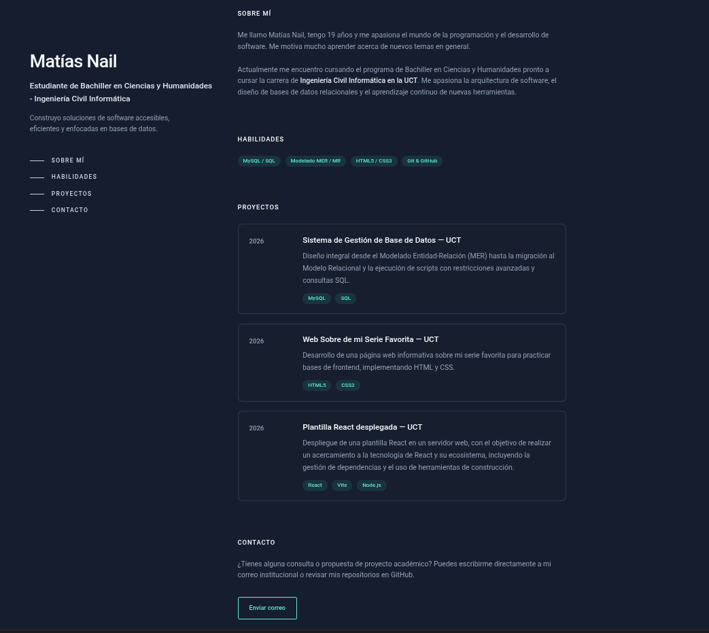

# Inventario de Migración: Evaluación N°2 → Evaluación N°4 (React + TypeScript)

## 1. Referencia Visual Original

## 2. Mapeo de Secciones y Componentes
| Elemento en E2 (`index.html`) | Equivalente en React (`src/`) | Responsabilidad y Mejoras |
| :--- | :--- | :--- |
| `<header class="sidebar">` + `<nav>` | `components/Sidebar.tsx` | Navegación declarativa con `<NavLink>` y retorno al inicio con `<Link to="/">`. |
| `<section id="sobre-mi">` | `pages/SobreMi.tsx` | Vista independiente en ruta `/` y `/sobre-mi`, desacoplada de texto en JSX. |
| `<section id="habilidades">` | `pages/Habilidades.tsx` + `TagList.tsx` | Lista reutilizable de tecnologías alimentada desde `data/portfolioData.ts`. |
| `<section id="proyectos">` | `pages/Proyectos.tsx` + `ProjectCard.tsx` | Renderizado dinámico de proyectos propios + integración de `ReposGitHub.tsx`. |
| `<section id="contacto">` | `pages/Contacto.tsx` | Vista en ruta `/contacto` manteniendo enlace accesible de correo directo. |
| `<footer class="site-footer">` | `components/Footer.tsx` | Pie de página persistente con iconos SVG accesibles (`aria-hidden="true"`). |

## 3. Datos y Lógica Desacoplada
- **Datos estáticos (`src/data/portfolioData.ts`):** Textos de presentación, stack técnico y listado de proyectos tipados con interfaces (`ProjectItem`).
- **Consumo asíncrono (`src/hooks/useFetchApi.ts`):** Custom Hook genérico con manejo de estados (`loading`, `data`, `error`) y cancelación mediante `AbortController`.

## 4. Mejoras Aplicadas Respecto a la E2
- **Enrutamiento SPA:** Reemplazo de enlaces de ancla (`#seccion`) por rutas reales con `react-router-dom` y manejo de ruta 404 (`*`).
- **Nomenclatura BEM:** Estandarización de clases CSS (`bloque__elemento--modificador`) sobre `#root` evitando colisiones de especificidad.
- **Accesibilidad:** Conservación de *skip-link*, etiquetas semánticas HTML5 y atributos ARIA (`aria-live`, `role="status"`, `role="alert"`).